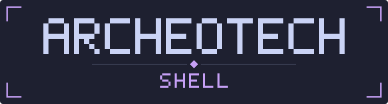
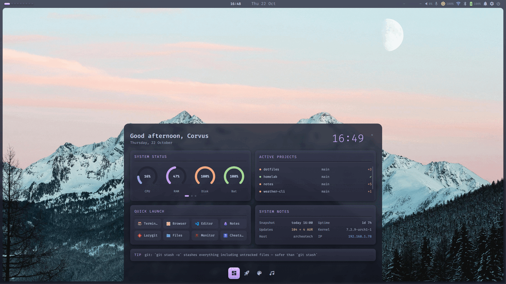
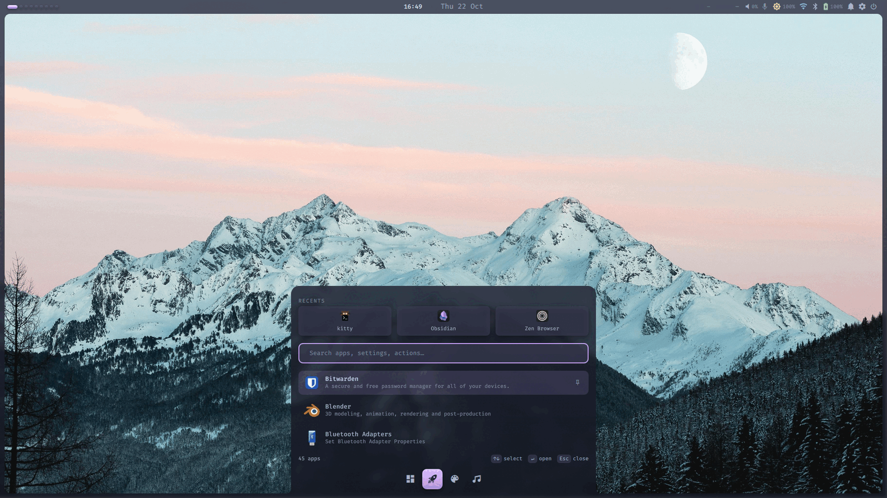
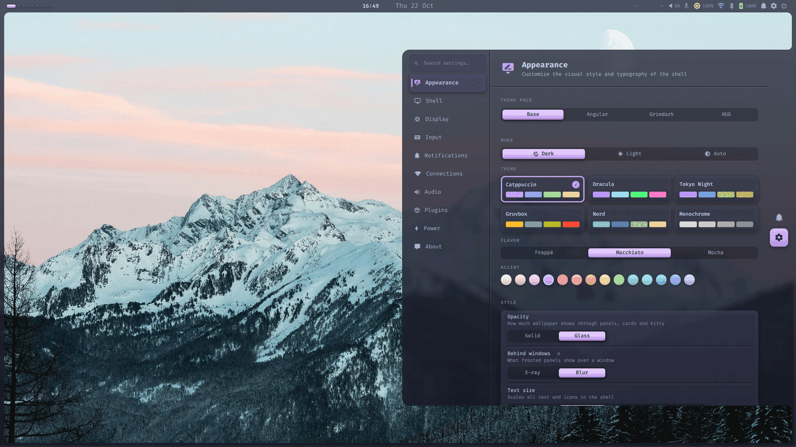
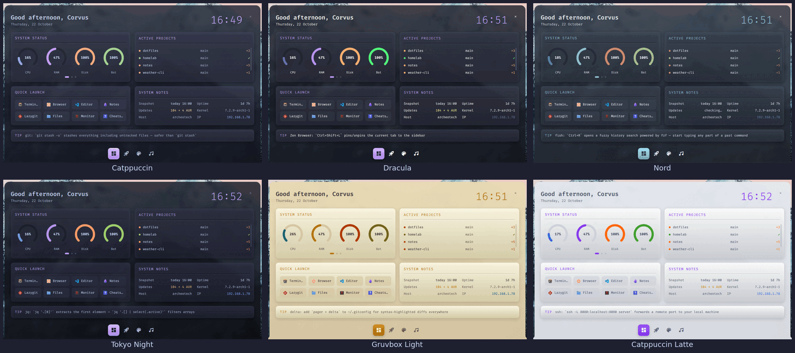
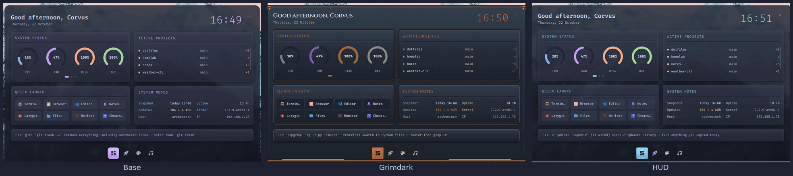
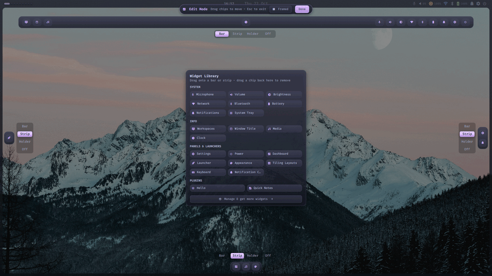
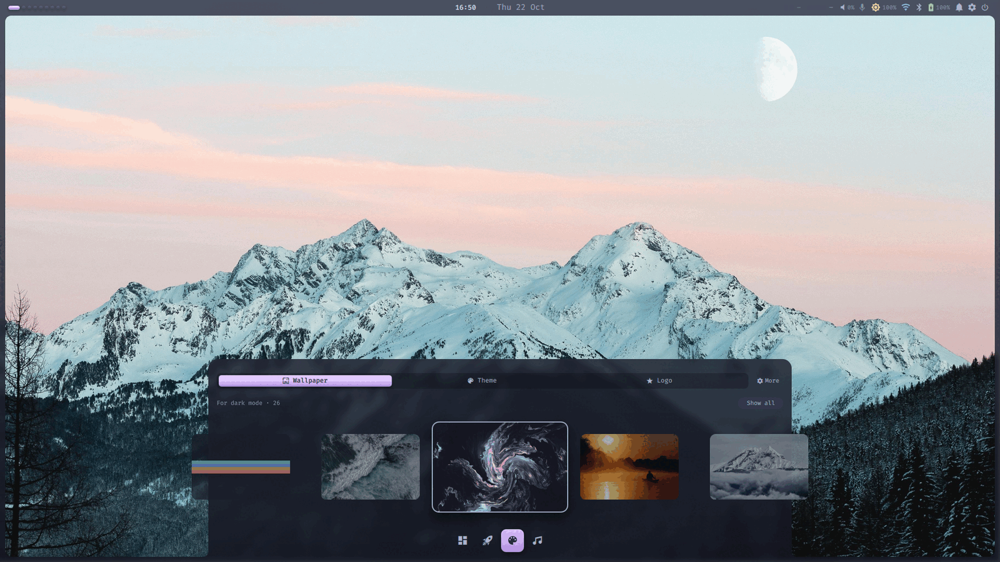

<div align="center">



### A complete desktop shell for Wayland. One theme for every app. A layout you arrange with the mouse.

[](LICENSE)




<sub>The dashboard on Catppuccin Macchiato, with real compositor blur. Demo projects, isolated render.</sub>

</div>

---

Archeotech is a [Quickshell](https://quickshell.org) desktop shell for MangoWC and Hyprland.
It draws the bar, side strips, launcher, dashboard, notifications, OSD, wallpaper picker and settings
in one process and one glass frame. A theme change recolours the shell and your apps together:
kitty, GTK, rofi, fish, starship, hyprlock, VS Code, Obsidian and the compositor borders.
Every bar item and panel is a module. You place them in edit mode and the layout reloads live.

## A day with Archeotech

- **Morning.** You dock the laptop. The display profile for that desk applies itself.
- **Work.** `Super+Space` opens the launcher. One search box finds apps, settings and actions.
- **A new shortcut.** `Super+K` lists every compositor bind, labelled for the keyboard you type on.
- **Late afternoon.** The room gets bright. You pick a light theme and the terminals, GTK apps and shell follow.
- **Weekend.** You move the clock to a side strip and add a notes panel. No file to edit.

## Why you want it

| You have | Archeotech gives you |
|---|---|
| A bar, a launcher, a notifier and a wallpaper tool that each look different | **One shell** with one material and one set of tokens |
| A theme that stops at the terminal | **One switch** for 13 official palettes, a flavor and an accent, applied to 11 targets |
| A config file to edit for every layout change | **Edit mode**: drag widgets onto a bar, a strip or a holder |
| Displays that change between home and work | **Per-monitor profiles** applied on dock and undock |
| Settings scattered across tools | **One Settings panel** with search and a reset per setting |
| A look you want to make your own | **Theme packs** that change the material, the frames and the fonts |

## See it

### Launcher
Apps, settings and shell actions in one list. Recent apps on top.



### Settings
Theme family, flavor and accent. Solid or Glass, X-ray or real blur behind windows, text size.
Displays, input, audio, connections, plugins and power. Every setting is searchable and resets to its default in one click.



### Themes
13 palettes from the official upstream sources, dark and light. CI checks every text colour for contrast.



### Theme packs
A pack changes the material on top of the palette. Base, Angular, Grimdark and HUD ship with the shell.



### Edit mode
Pick what each side of the screen is: a bar, an icon strip, a holder or nothing. Drag widgets from the library onto it.



### Keyboard
Shortcuts and special characters in one panel. Hover a combo and the keyboard diagram lights its keys.


### Wallpapers
Thumbnails per mode, with the logo overlay and the theme one tab away.



## Get started

1. Install [Quickshell](https://quickshell.org) 0.3.0 or newer, a Nerd Font and an icon theme (Papirus recommended).
2. Clone and install:
   ```sh
   git clone https://github.com/Nicolas-Rigaudy/archeotech-shell.git ~/Projects/archeotech-shell
   cd ~/Projects/archeotech-shell
   ./scripts/install.sh --dry-run   # preview, then run it without the flag
   ```
3. Add the required rules and keybinds to your compositor from [`examples/`](examples/)
   ([MangoWC](examples/mangowc.conf.example), [Hyprland](examples/hyprland.conf.example)).
4. Start it with `qs -c archeotech`.

The installer links the repo to `~/.config/quickshell/archeotech`, adds the theme packages and two wallpapers,
and puts the helper scripts on your `PATH`. Optional tools (NetworkManager, bluez, brightnessctl, awww and others)
light up their widgets when present. The full list is in [`docs/INSTALL.md`](docs/INSTALL.md).

Want the whole desktop around it? [archeotech-dotfiles](https://github.com/Nicolas-Rigaudy/archeotech-dotfiles)
is the machine config this shell runs on.

<details>
<summary><b>What is in the box</b></summary>

| Path | What |
|---|---|
| `shell.qml` | entry point: one frame per monitor with its bar, strips and panels |
| `Modules/` | dashboard, launcher, notifications, OSD, settings, edit mode, panels |
| `Widgets/Bar/` | bar widgets, mounted by file name (`<Id>Widget.qml`) |
| `Services/` | audio, network, Bluetooth, displays, media, compositor IPC, config |
| `Commons/` | design tokens, primitives, animation |
| `themes/`, `packs/` | palettes and theme packs |
| `modules/` | plugins (a folder with a `module.json`) |
| `scripts/` | installer, theme switch, wallpaper, display profiles, render tools |
| `tests/` | logic tests and 25 golden renders |

</details>

<details>
<summary><b>Extend it</b></summary>

- Write a widget or a panel: [`docs/MODULE_API.md`](docs/MODULE_API.md), [`docs/WIDGET_API.md`](docs/WIDGET_API.md), [`docs/PANEL_API.md`](docs/PANEL_API.md)
- Make a theme: [`docs/THEME_SPEC.md`](docs/THEME_SPEC.md)
- Make a theme pack: [`docs/THEME_PACK.md`](docs/THEME_PACK.md), [`docs/STYLE_API.md`](docs/STYLE_API.md)
- MangoWC notes: [`docs/MANGOWC-SETUP.md`](docs/MANGOWC-SETUP.md)

</details>

<details>
<summary><b>Develop</b></summary>

- `scripts/shot.sh` renders the shell in an isolated headless compositor. Your running session stays untouched.
- `tests/run.sh` runs the logic tests. `scripts/golden.sh` compares 25 renders against the goldens.
- CI runs qmllint, the logic tests, palette fidelity and contrast checks.
- Regenerate the screenshots above: [`docs/screenshots.md`](docs/screenshots.md).

</details>

## License

[GPL-3.0](LICENSE). Theme packs and plugins kept in their own repositories may use their own license.
The bundled wallpapers are from [Pexels](https://www.pexels.com/license/).
